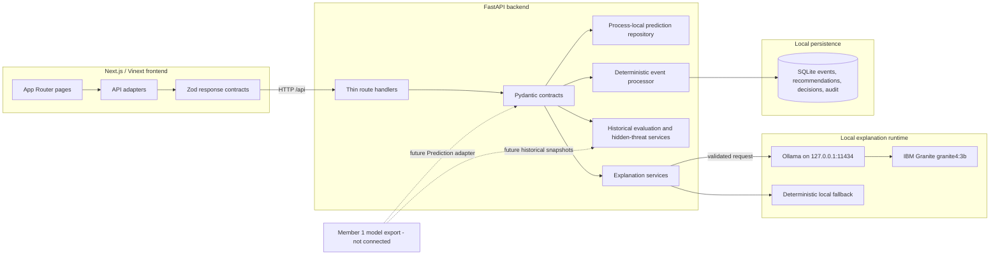
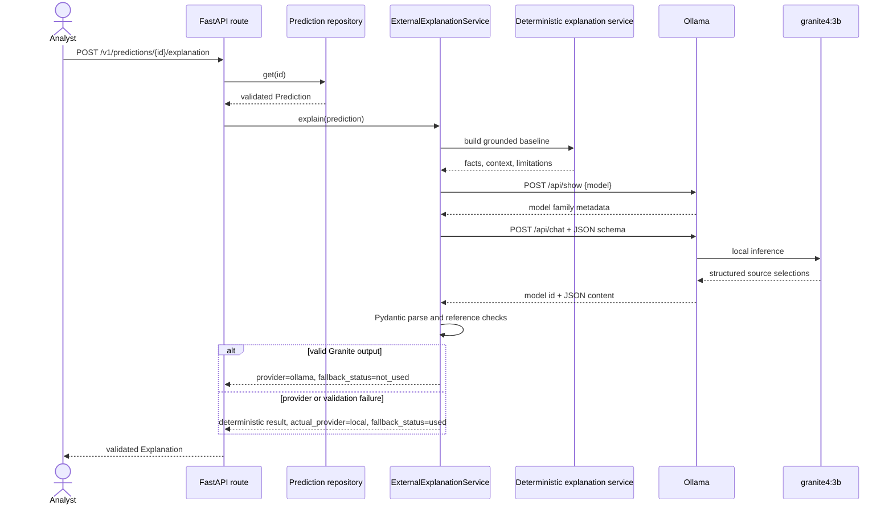
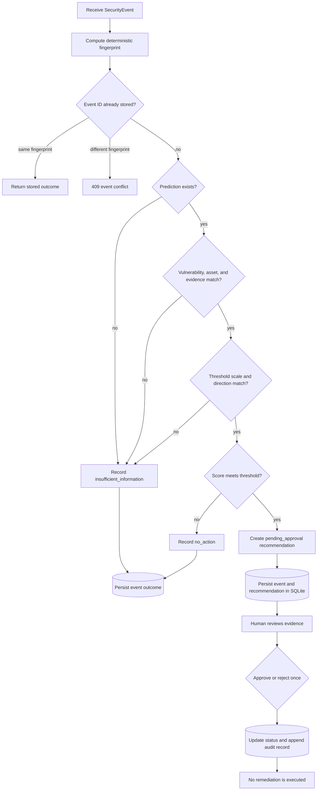

# SignalZero

SignalZero is a vulnerability-prioritization and security-workflow prototype built for the
Sheridan Datathon 2026 IBM challenge. It combines a browser application, a contract-first
FastAPI backend, deterministic historical-ranking utilities, evidence-grounded explanations,
and a human approval workflow.

The system is deliberately honest about its current boundary: Member 1's trained prediction
model and real historical exports are not integrated on this branch. Live frontend routes
therefore return empty or unavailable states instead of manufactured rankings, findings, or
alerts. The backend prediction contract is the future model-adapter boundary.

## 1. Project overview

Conventional vulnerability queues often sort by one present-day measure such as CVSS severity
or EPSS probability. Those values answer useful but narrower questions: CVSS describes technical
severity, while EPSS estimates exploitation probability for a defined horizon. Neither alone
captures an organization's supplied asset context, model-specific signals, or whether a ranking
would have been useful at an earlier decision point.

SignalZero separates those concerns:

- predictions declare their score scale and risk direction instead of assigning implicit meaning;
- explanations can only cite fields and evidence supplied with a prediction;
- historical evaluation freezes features at a monthly cutoff and evaluates later outcomes at a
  separate cutoff;
- hidden-threat comparisons require comparable model and baseline ranks;
- security events are correlated deterministically and can create recommendations requiring a
  recorded human decision;
- local IBM Granite can help select relevant submitted evidence, but it never produces or changes
  the risk score.

Currently functional are the integrated frontend, live browser-to-FastAPI communication, Zod and
Pydantic validation, deterministic prediction and event workflows, SQLite event persistence,
historical-evaluation services with synthetic tests, local Granite inference through Ollama, and
deterministic explanation fallback.

## 2. Table of contents

1. [Project overview](#1-project-overview)
2. [Table of contents](#2-table-of-contents)
3. [How SignalZero works](#3-how-signalzero-works)
4. [System architecture](#4-system-architecture)
5. [Frontend architecture](#5-frontend-architecture)
6. [Backend architecture](#6-backend-architecture)
7. [IBM Granite integration](#7-ibm-granite-integration)
8. [Data flow and processing](#8-data-flow-and-processing)
9. [Time Machine and historical evaluation](#9-time-machine-and-historical-evaluation)
10. [Hidden Threat Detector](#10-hidden-threat-detector)
11. [API reference](#11-api-reference)
12. [Data contracts](#12-data-contracts)
13. [Repository structure](#13-repository-structure)
14. [Local development setup](#14-local-development-setup)
15. [Environment variables](#15-environment-variables)
16. [Testing and validation](#16-testing-and-validation)
17. [Demo walkthrough](#17-demo-walkthrough)
18. [Limitations and future integration](#18-limitations-and-future-integration)

## 3. How SignalZero works

### Browser and live API workflow

The App Router pages under [`frontend/app`](frontend/app) call focused adapters in
[`frontend/lib/api`](frontend/lib/api). With `NEXT_PUBLIC_SIGNALZERO_API_MODE=live`, those adapters
request the FastAPI `/api` routes. Every successful payload is parsed by the Zod schemas in
[`frontend/lib/types/contracts.ts`](frontend/lib/types/contracts.ts). Network errors, non-JSON
responses, non-2xx responses, and schema mismatches are surfaced to the page; live mode never
silently substitutes demo fixtures.

Until a real prediction export is connected, the backend returns nullable dashboard totals and
empty live collections. Replay requests for supported months return an explicit
`historical_data_unavailable` error. The pages translate these results into empty or unavailable
states without presenting simulated data as live output.

### Prediction and explanation workflow

`POST /v1/predictions` accepts a versioned `Prediction`. Pydantic checks its declared score scale,
rank, evidence timestamps, unique identifiers, asset associations, and evidence references. The
prediction is stored in a thread-safe, process-local repository. It is intentionally not durable.

`POST /v1/predictions/{prediction_id}/explanation` retrieves that prediction and produces an
explanation. The deterministic provider restates submitted fields. The Ollama provider sends a
restricted prompt and JSON schema to local Granite, validates the returned source-reference
selection, and exposes deterministic wording rather than untrusted model-authored factual text.

### Historical and hidden-threat workflow

The historical services accept a frozen `HistoricalSnapshot`, reject training rows and post-cutoff
evidence, create model/CVSS/EPSS rankings over comparable populations, and calculate evaluation
metrics. The Hidden Threat Detector finds candidates ranked inside a model budget but outside the
same baseline budget. These services are implemented and tested with visibly synthetic fixtures;
they are not connected to the live frontend because Member 1's real out-of-sample export is still
pending.

### Security event and approval workflow

`POST /v1/security-events` correlates an event with an existing process-local prediction. It checks
the vulnerability identity, affected asset, evidence references, and exact score-scale semantics.
A compatible score meeting the configured threshold creates a SQLite-backed recommendation in
`pending_approval`. A reviewer may approve or reject it once. That decision is persisted with an
audit record; no endpoint runs a patch, command, account change, or infrastructure action.

## 4. System architecture



The frontend and backend communicate directly on loopback during local development. CORS permits
the explicit frontend origin only. SQLite stores workflow state, not prediction records. Granite
is optional at runtime because deterministic local explanations remain available without network
access or credentials.

## 5. Frontend architecture

The frontend is isolated under [`frontend/`](frontend):

- [`app/page.tsx`](frontend/app/page.tsx) renders the vulnerability overview.
- [`app/time-machine/page.tsx`](frontend/app/time-machine/page.tsx) renders monthly replay and
  handles unavailable history explicitly.
- [`app/hidden-threats/page.tsx`](frontend/app/hidden-threats/page.tsx) renders comparable ranking
  disagreements.
- [`app/assets/page.tsx`](frontend/app/assets/page.tsx) renders asset inventory and matches.
- [`app/alerts/page.tsx`](frontend/app/alerts/page.tsx) renders alert delivery and lifecycle state.
- [`components/app-shell.tsx`](frontend/components/app-shell.tsx) owns shared navigation and layout.
- [`components/ui`](frontend/components/ui) contains the shared UI primitives.
- [`lib/api/service.ts`](frontend/lib/api/service.ts) selects live endpoints or explicit demo data.
- [`lib/api/http.ts`](frontend/lib/api/http.ts) performs fetch, error normalization, and Zod parsing.
- [`lib/types/contracts.ts`](frontend/lib/types/contracts.ts) defines the browser-side API boundary.

The project uses the Next.js App Router API through Vinext/Vite for its local and hosted build
pipeline. The `@/*` TypeScript alias resolves from the `frontend/` project root. Tailwind is loaded
through the PostCSS and Vite plugins, and public assets are served from `frontend/public/`.

### Live and demo modes

- `live` calls FastAPI and displays network, HTTP, JSON, and contract failures.
- `demo` uses explicitly simulated fixtures in `frontend/lib/data`.
- Mode selection is explicit; live failures do not fall back to demo data.

Each page owns loading, failure, empty, and available states. A missing value remains `null` and is
displayed as unavailable or not provided. In Hidden Threats, both a valid model rank and a valid
traditional rank are required before a vulnerability can be classified outside the top 500.

## 6. Backend architecture

[`backend/app/main.py`](backend/app/main.py) creates the FastAPI application, loads settings,
constructs repositories and services, installs explicit CORS middleware, adds trace IDs, and maps
domain failures to structured error responses. [`backend/app/api.py`](backend/app/api.py) contains
thin route handlers and dependency accessors.

The principal layers are:

- **Contracts:** [`backend/app/domain/contracts.py`](backend/app/domain/contracts.py) contains
  strict versioned Pydantic models. Extra fields and non-finite numbers are rejected.
- **Frontend adapters:** [`backend/app/domain/frontend_contracts.py`](backend/app/domain/frontend_contracts.py)
  defines the current `/api` response wrappers.
- **Prediction repository:** [`backend/app/repositories.py`](backend/app/repositories.py) stores
  defensive copies in memory under a lock. Data disappears when FastAPI restarts.
- **Explanation services:** [`backend/app/services/explanations.py`](backend/app/services/explanations.py)
  builds deterministic facts and validates external-provider output.
- **Provider clients:** [`backend/app/services/providers.py`](backend/app/services/providers.py)
  contains local Ollama, hosted-provider compatibility, transport handling, and output validation.
- **Historical evaluation:** [`backend/app/services/historical_evaluation.py`](backend/app/services/historical_evaluation.py)
  compares model, CVSS, and EPSS rankings on a shared cohort.
- **Hidden threats:** [`backend/app/services/hidden_threats.py`](backend/app/services/hidden_threats.py)
  evaluates model-versus-baseline top-K disagreements.
- **Event processing:** [`backend/app/services/event_processing.py`](backend/app/services/event_processing.py)
  correlates events and applies a scale-bound threshold deterministically.
- **Workflow persistence:** [`backend/app/event_repository.py`](backend/app/event_repository.py)
  persists event idempotency, recommendations, one-time decisions, and audit records in SQLite.

Approval transitions are limited from `pending_approval` to either `approved` or `rejected`.
Repeating a decision returns a conflict rather than rewriting history.

## 7. IBM Granite integration

The verified local configuration uses:

- model: `granite4:3b`
- runtime: Ollama
- endpoint: `http://127.0.0.1:11434`
- provider setting: `EXPLANATION_PROVIDER=ollama`

`OllamaGraniteClient` only accepts loopback HTTP origins and ignores proxy environment variables
for local calls. Before inference it calls Ollama `/api/show` and requires a reported model family
or architecture containing `granite`. It then calls `/api/chat` with temperature `0`, streaming
disabled, and the JSON schema generated from `ProviderOutput`.

The prompt contains the submitted prediction, allowed source references, and grounding rules.
Pydantic parses the returned JSON and rejects unknown reference identifiers. The API response uses
deterministic text describing the validated references; it does not expose free-form model claims.
The final `Explanation` validates its references again against the prediction.

Timeouts, unavailable transport, unsupported status codes, missing models, model identity
mismatches, malformed JSON, schema failures, and unknown references trigger the deterministic
fallback. `provider_metadata` records the requested provider, actual provider, requested generation
status, and whether fallback was used. Granite never calculates, modifies, or validates the risk
score; it receives an already-created prediction.



## 8. Data flow and processing

### Prediction ingestion

1. The caller submits `schema_version: "1.0"`, score semantics, vulnerability identity, optional
   rank, signals, affected assets, and evidence.
2. Pydantic rejects out-of-scale scores, duplicate IDs, post-snapshot evidence, and dangling refs.
3. The process-local repository rejects duplicate prediction IDs and stores a defensive copy.

### Historical replay

A validated snapshot freezes its candidate population and feature cutoff. Historical services rank
the shared population and compute outcomes only through the evaluation cutoff. The live `/api/replay`
adapter currently reports unavailable because no real Member 1 export has been connected.

### Event, recommendation, and decision processing



The threshold configuration must match the prediction's minimum, maximum, and
`higher_is_riskier` direction exactly. A semantic mismatch is not guessed around; it produces an
insufficient-information outcome.

## 9. Time Machine and historical evaluation

The historical domain models a monthly decision snapshot rather than rebuilding the past using
today's data. Each candidate declares that it is out of sample and includes the historical model
score, score scale, model version, and optional baseline observations.

- **Snapshot month:** `YYYY-MM`, matching the month containing `feature_cutoff`.
- **Historical CVSS:** score, source, and observation timestamp available by the cutoff.
- **Historical EPSS:** probability and observation timestamp available by the cutoff.
- **KEV `dateAdded`:** a later outcome, never a predictive feature. A date after the evaluation
  cutoff remains `unknown` for that evaluation.
- **Out-of-sample requirement:** training rows are rejected.
- **Temporal leakage controls:** post-cutoff evidence, baseline timestamps, publications, and CVEs
  already known as KEV at prediction time are rejected.
- **Shared population:** comparisons use candidates with both CVSS and EPSS present so model and
  baselines are evaluated on the same rows.

For a budget K:

- **Hits@K** is the number of confirmed-by-cutoff KEV outcomes among the first K ranked rows.
- **Precision@K** is `Hits@K / evaluated K`.
- **Recall@K** is `Hits@K / all confirmed positives` and is `null` when there are no positives.
- **Average precision** accumulates precision at positive ranks and divides by total positives.
- **Coverage** reports total candidates, shared candidates, and available CVSS/EPSS comparison
  counts so missing baseline data remains visible.

The service evaluates budgets 10, 25, 50, 100, and 500. The frontend selector recognizes months
from January 2024 through December 2025. Syntactically valid months outside that range return
`unsupported_month`; supported months return `historical_data_unavailable` until real prediction
snapshots are integrated.

## 10. Hidden Threat Detector

The detector supports `model_vs_cvss` and `model_vs_epss`. For one frozen cohort it:

1. excludes candidates without the selected baseline value;
2. ranks model and baseline scores using their declared directions and CVE ID as a stable tie-breaker;
3. selects candidates with `model_rank <= K < baseline_rank`;
4. reports the rank difference, scores, cutoff-bounded KEV outcome, and submitted evidence.

This is a ranking-disagreement detector, not proof of exploitability. Subsequent KEV status is an
evaluation outcome and is not fed back as a predictive feature. Missing baseline values and null
traditional ranks mean **unknown**. They must never be interpreted as outside a conventional top-K
list. The frontend enforces the same rule by requiring non-null model and traditional ranks before
displaying a hidden threat.

## 11. API reference

Interactive OpenAPI documentation is available at `http://127.0.0.1:8000/docs` while FastAPI is
running.

### Frontend-compatible routes

| Method | URL | Purpose | Current live behavior |
|---|---|---|---|
| `GET` | `/api/overview` | Dashboard totals and priority vulnerabilities | Nullable totals and an empty list |
| `GET` | `/api/vulnerabilities` | Validated vulnerability collection | Empty live collection |
| `GET` | `/api/vulnerabilities/{vulnerability_id}` | One vulnerability | `404 vulnerability_not_found` until an adapter exists |
| `GET` | `/api/replay?month=YYYY-MM` | Historical ranking replay | `503 historical_data_unavailable` for supported months |
| `GET` | `/api/assets` | Asset inventory and matches | Empty live collections |
| `GET` | `/api/alerts` | Frontend alert activity | Empty live collection |

Example overview response:

```json
{
  "summary": {
    "totalVulnerabilities": null,
    "criticalPriority": null,
    "exposedAssets": null,
    "predictionHorizonDays": null
  },
  "priorityVulnerabilities": [],
  "generatedAt": "2026-11-08T01:00:00Z",
  "source": "live"
}
```

### Versioned backend routes

| Method | URL | Request | Response | Important errors |
|---|---|---|---|---|
| `GET` | `/health` | None | Provider readiness | `503` when selected provider configuration is incomplete |
| `POST` | `/v1/predictions` | `Prediction` | Created `Prediction` | `409` duplicate ID, `422` validation |
| `GET` | `/v1/predictions/{prediction_id}` | None | `Prediction` | `404` missing prediction |
| `POST` | `/v1/predictions/{prediction_id}/explanation` | None | `Explanation` | `404` missing prediction; provider failures fall back locally |
| `POST` | `/v1/security-events` | `SecurityEvent` | `EventProcessingOutcome` | `409` conflicting event ID, `422` validation, `503` store failure |
| `GET` | `/v1/security-events/{event_id}` | None | `EventProcessingOutcome` | `404` missing event, `503` store failure |
| `GET` | `/v1/predictions/{prediction_id}/recommendations` | None | Recommendation array | `503` store failure |
| `POST` | `/v1/recommendations/{recommendation_id}/decision` | `RecommendationDecision` | Updated recommendation | `404`, `409` invalid transition, `422`, `503` |

Concise prediction request:

```json
{
  "schema_version": "1.0",
  "prediction_id": "synthetic-prediction-001",
  "snapshot_date": "2026-01-15",
  "vulnerability": {
    "vulnerability_id": "SYNTH-VULN-001",
    "source": "synthetic-test-fixture",
    "aliases": []
  },
  "score": 0.82,
  "score_scale": {"minimum": 0.0, "maximum": 1.0, "higher_is_riskier": true},
  "rank": 2,
  "model_version": "synthetic-model-v1",
  "signals": [],
  "affected_assets": [],
  "evidence": []
}
```

Decision request:

```json
{
  "schema_version": "1.0",
  "action": "approve",
  "actor": "synthetic-reviewer",
  "reason": "Synthetic demonstration approval only."
}
```

Errors contain a stable code, message, validation details, schema version, and trace ID. The
frontend error schema reads the nested code/message/details and safely ignores additional metadata.

## 12. Data contracts

| Contract | Important semantics |
|---|---|
| `Prediction` | Declares snapshot, vulnerability, score, scale, direction, rank, model version, signals, assets, and evidence. |
| Frontend vulnerability | Nullable CVSS, EPSS, ranks, risk, asset, and timestamps; `rankingScore` is relative, not a probability. |
| `Evidence` | Timestamped, source-labelled input known by the prediction snapshot. |
| `Explanation` | Separates context, observed facts, interpretations, limitations, trace ID, and provider metadata. |
| `SecurityEvent` | References one prediction, vulnerability, asset, and one or more submitted evidence IDs. |
| `RemediationRecommendation` | Stores threshold rationale, evidence refs, next step, and required approval state. |
| `HistoricalEvaluation` | Contains cutoff-bounded rankings, coverage, per-strategy metrics, and model/baseline comparisons. |
| Provider metadata | Identifies requested/actual provider, model, generation result, and fallback use. |

Public backend contracts use `schema_version: "1.0"`. Pydantic is authoritative at ingestion and
backend response construction. Zod independently validates the browser-facing `/api` payloads.
The two layers intentionally form an adapter boundary: the frontend is not coupled to a training
implementation, and the backend does not infer absent score semantics.

JSON Schemas and synthetic examples are versioned under
[`backend/contracts/v1`](backend/contracts/v1). The proposed frontend contract is retained at
[`docs/frontend-api-contract.md`](docs/frontend-api-contract.md).

## 13. Repository structure

```text
sheridanIBM/
├── frontend/
│   ├── app/                    # App Router pages and global styles
│   ├── components/             # Shared shell and UI primitives
│   ├── hooks/                  # Frontend hooks
│   ├── lib/
│   │   ├── api/                # Live/demo adapters and validated HTTP client
│   │   ├── data/               # Explicitly simulated demo fixtures
│   │   └── types/              # Zod contracts and view models
│   ├── public/                 # Static browser assets
│   ├── db/, drizzle/           # Optional frontend-hosting database scaffolding
│   ├── scripts/, worker/       # Vinext, Cloudflare, and preview tooling
│   ├── package.json
│   └── tsconfig.json
├── backend/
│   ├── app/
│   │   ├── domain/             # Pydantic contracts and domain errors
│   │   ├── features/           # Deterministic text hashing adapter
│   │   ├── services/           # Explanations, history, hidden threats, events
│   │   ├── api.py              # Route handlers
│   │   └── main.py             # Application composition and middleware
│   ├── contracts/v1/           # JSON Schemas and synthetic examples
│   ├── scripts/                # Contract export tooling
│   ├── tests/                  # Offline, contract, workflow, and opt-in live tests
│   └── pyproject.toml
├── docs/                       # Integration and demo guides
├── .env.example               # Non-secret configuration template
├── .gitignore
├── AGENTS.md                   # Repository engineering constraints
└── README.md
```

There is no `model/` directory on this branch. Member 1's work remains outside this integration
milestone and will connect later through the prediction and historical-snapshot contracts.

## 14. Local development setup

Prerequisites: Python 3.11+, Node.js 22.22+, npm, Ollama, and the already-installed
`granite4:3b` model.

### 1. Configure local environment files

From the repository root, create files only when they do not already exist:

```powershell
if (!(Test-Path frontend\.env.local)) { Copy-Item .env.example frontend\.env.local }
if (!(Test-Path backend\.env)) { Copy-Item .env.example backend\.env }
```

Do not overwrite an existing `backend/.env`; it may contain local provider configuration.

### 2. Install frontend dependencies

```powershell
cd frontend
npm.cmd ci
cd ..
```

### 3. Install backend dependencies

```powershell
cd backend
python -m pip install -e ".[dev]"
cd ..
```

### 4. Start and verify Ollama

In a dedicated PowerShell window if Ollama is not already running:

```powershell
ollama serve
```

Verify the existing model without downloading or replacing it:

```powershell
ollama list | Select-String 'granite4:3b'
```

### 5. Start FastAPI

```powershell
cd backend
python -m uvicorn app.main:app --reload --host 127.0.0.1 --port 8000
```

### 6. Start the frontend

In another PowerShell window:

```powershell
cd frontend
npm.cmd run dev -- --port 3000
```

### 7. Open and inspect the application

Open `http://localhost:3000`. FastAPI documentation is at
`http://127.0.0.1:8000/docs`.

### 8. Check backend health

```powershell
Invoke-RestMethod http://127.0.0.1:8000/health
```

Health reports configuration readiness; the opt-in live smoke test in the testing section verifies
an actual Granite inference.

## 15. Environment variables

| Variable | Used by | Required | Purpose |
|---|---|---|---|
| `NEXT_PUBLIC_SIGNALZERO_API_MODE` | Frontend | Yes for live integration | `live` calls FastAPI; `demo` uses simulated fixtures. |
| `NEXT_PUBLIC_SIGNALZERO_API_BASE_URL` | Frontend | In live mode | Browser-visible base URL, normally `http://127.0.0.1:8000`. |
| `CORS_ALLOWED_ORIGINS` | Backend | For browser integration | Explicit comma-separated origins, normally `http://localhost:3000`; wildcards are rejected. |
| `EXPLANATION_PROVIDER` | Backend | No | `local` by default; use `ollama` for local Granite. |
| `OLLAMA_BASE_URL` | Backend | With Ollama | Loopback HTTP origin, normally `http://127.0.0.1:11434`. |
| `OLLAMA_MODEL` | Backend | With Ollama | Exact model ID, `granite4:3b`. |
| `EVENT_DATABASE_PATH` | Backend | No | Local SQLite path; defaults to `security_events.db`. |
| `EVENT_RISK_THRESHOLD` | Backend | For recommendation creation | Threshold value on the declared prediction scale. |
| `EVENT_THRESHOLD_SCALE_MINIMUM` | Backend | With threshold | Required matching scale minimum. |
| `EVENT_THRESHOLD_SCALE_MAXIMUM` | Backend | With threshold | Required matching scale maximum. |
| `EVENT_THRESHOLD_HIGHER_IS_RISKIER` | Backend | With threshold | Required matching risk direction. |
| `PROVIDER_CONNECT_TIMEOUT` | Backend | No | Provider connection timeout in seconds. |
| `PROVIDER_READ_TIMEOUT` | Backend | No | Provider response timeout in seconds. |
| `PROVIDER_MAX_OUTPUT_TOKENS` | Backend | No | Structured provider-output limit. |

The repository also retains dormant hosted-provider settings for compatibility. Never commit API
keys, credentials, production data, or local `.env` files. Every `NEXT_PUBLIC_` value is visible to
the browser and must not contain a secret.

## 16. Testing and validation

Run backend checks from `backend/`:

```powershell
python -m pytest
ruff check .
ruff format --check .
python -m compileall -q app tests scripts
```

Run frontend checks from `frontend/`:

```powershell
npm.cmd run lint
npm.cmd run build
```

Focused contract and synthetic workflow checks:

```powershell
cd backend
python -m pytest tests/test_contracts.py tests/test_frontend_api.py
python -m pytest tests/test_end_to_end_offline.py
python scripts/export_schemas.py
```

The schema export command rewrites generated contract files; review its diff before committing.

The live Granite smoke test is opt-in because it performs one real local inference:

```powershell
cd backend
$env:EXPLANATION_PROVIDER='ollama'
$env:OLLAMA_BASE_URL='http://127.0.0.1:11434'
$env:OLLAMA_MODEL='granite4:3b'
$env:LIVE_PROVIDER_SMOKE='1'
python -m pytest tests/test_live_provider.py -q
```

Verification performed for the repository-organization milestone:

- `npm ci`, frontend ESLint, and the production build passed from `frontend/`;
- 118 backend tests passed and one opt-in live-provider test was skipped;
- Ruff lint/format and Python compilation passed;
- all five frontend routes and the favicon returned HTTP 200;
- browser execution reached FastAPI with live-mode markers and no unexpected load error;
- CORS preflight accepted `http://localhost:3000`;
- desktop and 390-pixel mobile screenshots retained the existing layout.

No additional Granite inference was run for the directory move.

## 17. Demo walkthrough

All records used below are explicitly synthetic. They demonstrate contracts and workflow behavior,
not real vulnerability findings or model performance.

1. Start Ollama, FastAPI, and the frontend using [Local development setup](#14-local-development-setup).
2. Open `http://localhost:3000` and visit Overview, Time Machine, Hidden Threats, Company Assets,
   and Alert Activity.
3. Observe that live dashboard totals and collections are empty rather than replaced with fixtures.
4. On Time Machine, select a supported month and observe the explicit historical-unavailable state.
5. From a PowerShell window, submit the synthetic prediction:

```powershell
cd backend
curl.exe -X POST http://127.0.0.1:8000/v1/predictions `
  -H "Content-Type: application/json" `
  --data-binary "@contracts/v1/examples/prediction-create.synthetic.json"
```

6. Request one real local Granite explanation:

```powershell
curl.exe -X POST `
  http://127.0.0.1:8000/v1/predictions/synthetic-prediction-001/explanation
```

Check `provider`, `generation_status`, and `provider_metadata`. With a healthy verified Ollama
model, `actual_provider` is `ollama` and `fallback_status` is `not_used`. Otherwise the response is
the deterministic grounded explanation and truthfully reports fallback.

7. Submit the matching synthetic event:

```powershell
$outcome = curl.exe -X POST http://127.0.0.1:8000/v1/security-events `
  -H "Content-Type: application/json" `
  --data-binary "@contracts/v1/examples/security-event-create.synthetic.json" |
  ConvertFrom-Json

$outcome
```

The example `.env` threshold of `0.75` on a `0.0..1.0`, higher-is-riskier scale is compatible with
the synthetic prediction score of `0.82`, so a fresh workflow database creates a recommendation.
For repeatable demos, start FastAPI with a new ignored database path such as:

```powershell
$env:EVENT_DATABASE_PATH = "security_events.demo.$([DateTimeOffset]::UtcNow.ToUnixTimeSeconds()).db"
python -m uvicorn app.main:app --host 127.0.0.1 --port 8000
```

8. Review and approve the recommendation:

```powershell
curl.exe http://127.0.0.1:8000/v1/predictions/synthetic-prediction-001/recommendations

$decision = '{"schema_version":"1.0","action":"approve","actor":"synthetic-reviewer","reason":"Synthetic demonstration approval only."}'
curl.exe -X POST `
  "http://127.0.0.1:8000/v1/recommendations/$($outcome.recommendation_id)/decision" `
  -H "Content-Type: application/json" `
  -d $decision
```

Approval records workflow intent only. Nothing is patched or executed.

## 18. Limitations and future integration

- **Member 1 model:** not connected. The backend accepts prediction records but does not train or
  run the model.
- **Historical replay:** the evaluator and leakage controls exist, but live replay awaits genuine
  out-of-sample prediction exports with historical CVSS, EPSS, and cutoff metadata.
- **Live frontend findings:** intentionally empty until validated adapters supply real records.
- **Hidden threats:** the comparison logic exists, but the live page cannot claim findings without
  comparable real model and baseline ranks.
- **Prediction durability:** predictions are process-local and disappear on restart by design.
- **Workflow scope:** SQLite persists minimal event and approval state only; there is no automatic
  patching, remediation executor, authentication layer, Slack delivery, or Jira delivery service.
- **Granite hardware:** local latency and availability depend on the presentation machine and its
  Ollama runtime. Deterministic fallback remains functional without it.
- **Provider output:** Granite contributes validated source selection, not new vulnerability facts,
  remediation claims, or risk scores.
- **Decision Lab:** optional what-if or decision-analysis features are deferred and are not part of
  the current application.

The next integration milestone should adapt Member 1's confirmed outputs to `Prediction` and
`HistoricalSnapshot`, update schemas/fixtures/tests together, and preserve every declared score
scale, cutoff, evidence reference, and uncertainty value.
